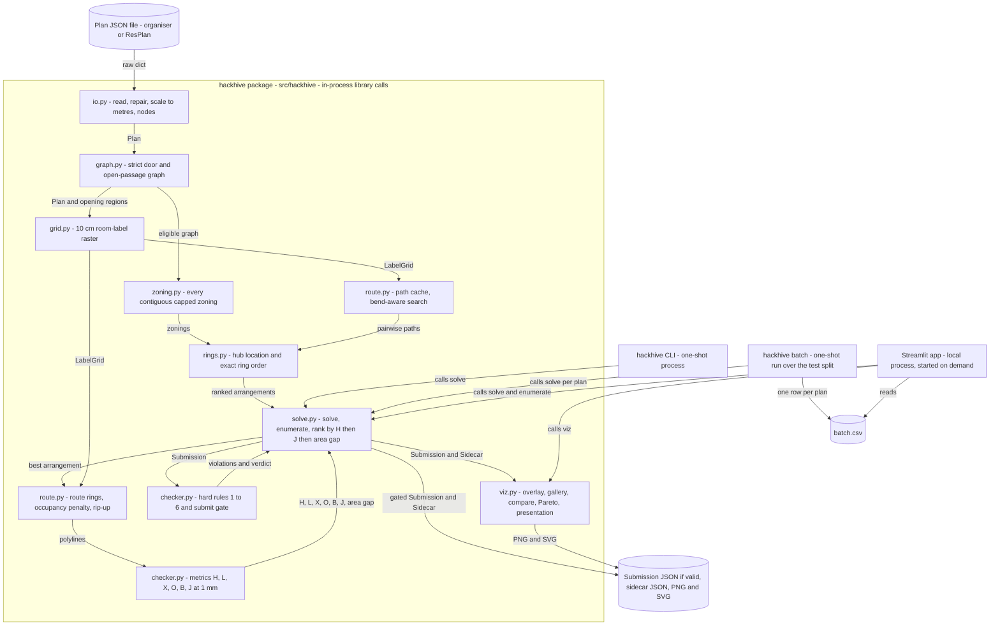
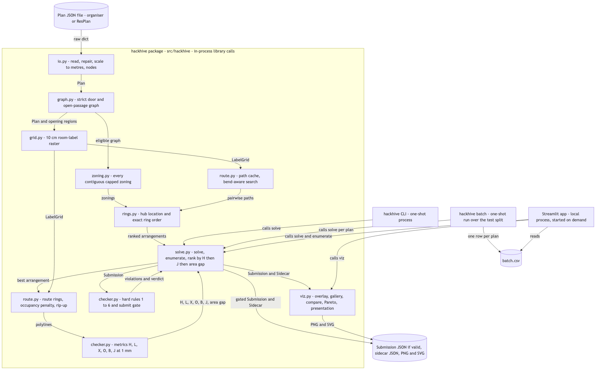

# hackhive architecture (PS4)

For every component, this doc says what it does, the data contract on each edge, the algorithm and its bound, the rules (C-ids) it enforces, the issues that build it, and **which reference repo each idea came from**, including what we chose not to take.

Lead's research notes live in Adi's Obsidian vault (not in this repo); this document summarises them. Board: [HACKHIVE PS4](https://github.com/users/Adityashandilya555/projects/5).

**Docs map:**
- `docs/decision_conventions.md`: how every edge case is decided;
- `docs/SPEC_COVERAGE.md`: every organiser requirement → issues → proof;
- `docs/NOVEL_FEATURES.md`: what we add beyond the spec;
- `docs/REFERENCES.md`: the reference repos;
- `docs/output-format.md`: the submission + sidecar format (#34).
- `docs/EXECUTION_PLAN.md`: who works on what, in parallel and in sequence (lane maps, waves, slots, critical path).

## 1. Overview
For any unseen floor plan, with no manual step, hackhive:
1. places **one fixed node per eligible room**;
2. groups the rooms into the **fewest contiguous hub zones** (≤ 100 m² and ≤ 5 nodes each), proven optimal by exhaustive search;
3. puts each hub inside an eligible room of its zone and orders **one closed ring per hub** exactly;
4. routes **axis-aligned cables that change rooms only through doors and open passages**;
5. outputs a validated JSON plus an overlay;
6. a Streamlit demo shows **every feasible arrangement**, with filters and a few novelty views.

### Sources
- The organisers' slides ("UR Hackathon 2026H2", slides 1-8) **win every conflict**.
- The Honeywell PS4 text fills gaps.
- Adi's answers are recorded as constraints.

### Rules the system must satisfy (C-ids)
| C | Rule | C | Rule |
|---|---|---|---|
| C1 | one fixed node per eligible room (living, bedroom, kitchen, storage) | C20 | invalid polygons are repaired |
| C2 | each eligible polygon is one room with one node | C21 | input: one JSON file per plan |
| C3 | node points are given by the organisers; immovable | C22 | processes an unseen plan with no manual step |
| C4 | excluded rooms (bathroom, balcony, stair, garden, pool, parking, land): no node, no hub | C23 | overlay: zones, **hub and node ids**, numbered order (the last = the return), full rings, **violations in red** |
| C5 | ≤ 100 m² of eligible area per hub | C24 | the output JSON is **slide 8 exactly** (metres, origin lower-left, y up) |
| C6 | ≤ 5 nodes per hub (≤ 20 is an optional what-if) | C25 | per-hub summary: rooms, m², nodes, length, bends |
| C7 | hubs ≥ max(⌈area/100⌉, ⌈nodes/cap⌉) | C26 | "What a reviewer confirms" checklist (slide 5) |
| C8 / C34 | a zone's rooms connect directly through door/opening links; excluded rooms never link | C27 | a room > 100 m² → an infeasible result, not a crash |
| C9 | every node in exactly one hub | C28 | naming: hub / node |
| C10 | ring H → N1 → … → Nk → same H, closed, each node once | C29 | all feasible arrangements, filterable; constraints configurable in the UI |
| C11 | invalid: open ends, branches, skipped/repeated nodes, ending at another hub | C30 | 7 low-effort novelty views |
| C12 | horizontal and vertical runs only | C31 | visible-first delivery |
| C13 | change rooms only through doors and open passages | C33 | by default a ring stays in its own hub's rooms, never through an excluded room or another hub's room (D7, 2026-10-16; allowing it is a WHAT-IF); overlaps and crossings between rings are cost, not violations |
| C14 | never through walls, windows or the outside; stay inside `inner` | C35 | each sprint ends with a pull-and-run-locally verification |
| C15 | single-door room: in and out through the same door, either a same-line retrace (its length counts as overlap) or two parallel runs (no overlap) | C36 | sprints carry no dates |
| C16 | rank: fewest hubs H first, then lowest J, then the smaller assigned-area gap | C37 | interior "windows": both readings, switched by a UI checkbox; default = obstacle |
| C17 | **J = L + 5X + O + 0.5B** (slides 3, 6; the weights are starting values, kept as settings) | C38 | the solver serves every given node; our ResPlan node generator folds unfit living slivers and reports them |
| C18 | hub inside an eligible room **assigned to it**, **≥ 0.5 m from walls**; a hub and a node may share a room (slide 3 rule 6) | C39 | a design must pass all six hard rules of slide 3 before it is ranked |
| C19 | metres = units ÷ √(inner.area / area), converted once per plan | C40 | metric semantics (slide 7): X counts inside one ring too; O = (k − 1) × length on the same line; B at vertices, nodes and the hub |
| C41 | tolerance 1 mm | C42 | the checker recomputes from polylines; reported values are ignored |
| C43 | **an invalid or missing plan scores zero** | C45 | a final-presentation visual |
| C46 | the input format is unknown; ids look like `R05`, `N1` | C47 | tie-break: the smaller assigned-area gap (max − min) |
| C48 | slide-8 format details (`location` object, `[x, y]` points, ordering, plan-global ids) | | |

### Assumptions
- **A1** The organiser JSON format is not published yet. The organiser adapter is #38 (Sprint 1, S1-A): it reads ResPlan-shaped geometry + an optional `nodes` field, tries the frame identity → `flip_y` → `origin_shift`, and fails loudly with `input_error`, never by guessing (#46 Q1, Q10).
- **A2** Our generated nodes sit at the max-clearance point, warned if < 0.5 m.
- **A3** Infeasible plans return reasons.
- **A4** ~~Crossing = two different rings crossing; overlap = shared run length.~~ → superseded by slide 6: X counts inside one ring and between rings (C40).
- **A6** Slide 1's "routes crossing only at doors or open passages" means changing rooms only through door or open-passage gaps (rule 5).
- **A7** ~~A hub is ≥ 0.5 m from every node~~ → superseded by slide 3 rule 6: ≥ 0.5 m from **walls**, and it may share a node's room (C18). We keep it ≥ 0.10 m from node points as a convention.
- **A8** ~~Ranking (hubs, cost, zone signature)~~ → superseded by slides 3/6: (H, J, area gap); the zone signature remains only as an internal, final tie-break (C16, C47).
- **A10** Windows are obstacles by default (C37 adds the other reading).

## 2. Pipeline
Arrows show **data flow**; each edge names the `contracts.py` model it carries. Every box is a Python module or a one-shot process; nothing is a long-running service.

- **Source:** `docs/architecture.mmd`.
- **Verified with** mermaid-cli 11.16.0 (pinned), and also renders without errors under mermaid 10.9, 9.4 and 8.13. The syntax is kept GitHub-safe: no HTML line breaks, no semicolons, no quoted edge labels.
- **Static copies:** `docs/architecture.svg` and `docs/architecture.png`.

If GitHub can't render the interactive diagram, the same picture is here:

**Which reference repo each box came from** (details in §3-4):

| Box | Reference ideas (verdict) |
|---|---|
| `io.py` | ResPlan loader helpers `normalize_keys` / `get_geometries` (Adopt, MIT copy) |
| `graph.py` | ResPlan `plan_to_graph` door attribution + open passages (Adapt, re-implemented strictly) |
| `zoning.py` | GerryChain contiguity (Adapt); HGS-CVRP lower-bound formula (Adapt) |
| `grid.py` | OrthoRoute portal snapping (Adapt) |
| `route.py` (path cache) | OrthoRoute multi-source seeds + ROI (Adapt); Freerouting door graph (concept only, GPL) |
| `rings.py` | PyVRP exact-vs-estimate cost evaluation → lower-bound pruning (Adapt) |
| `route.py` (route rings) | VTR PathFinder present-cost term + rip-up (Adapt / Adopt); OrthoRoute commit/clear (Adapt) |
| `checker.py` (metrics) | OptiWindNet fold detection and side test (Adapt); organiser slides 6-7 |
| `checker.py` (rules + gate) | OptiWindNet validator pattern (Adapt); GerryChain contiguity (Adapt); organiser slide 3 |
| `viz.py` | house-planner electric layer + summary panel (Adapt / Adopt); OptiWindNet `compare` / info box (Adapt / Adopt); ResPlan base layer (Adapt) |
| `solve.py`, CLI, batch, app | built from scratch; ResPlan `split.json` for batch (Adopt); pyvisgraph only in tests |

## 3. What we took from each reference repo
These are design ideas only. **No code is copied** except ResPlan's two loader helpers (MIT, notice kept). **Freerouting is GPL-3.0: concepts only, never code.** The full matrix (69 rows) is summarised here. Evidence is `path:Lstart-Lend @ sha`, read on 2026-10-15.

| Repo | License | Adopt / Adapt / Skip | Component(s) | What we took, in one line |
|---|---|---|---|---|
| m-agour/ResPlan | code MIT · data CC BY 4.0 (`croissant.json` says CC BY-NC-SA 4.0) | 2 / 4 / 4 | io, graph, viz, batch | the `normalize_keys` / `get_geometries` loader helpers (copied); door attribution and open-passage detection (re-implemented strictly); base-plan styling; `split.json` |
| mggg/GerryChain | BSD-3 | 0 / 2 / 2 | zoning, validate | zone contiguity = `nx.is_connected` on the eligible door/opening graph, with fragments in violation messages |
| PyVRP/PyVRP | MIT | 0 / 1 / 4 | rings | exact-vs-estimate cost evaluation → lower-bound early exit when scoring rings |
| vidalt/HGS-CVRP | MIT | 0 / 1 / 4 | zoning | the two-capacity lower-bound formula only |
| bbenchoff/OrthoRoute | MIT | 0 / 5 / 2 | grid, route | cell snapping, multi-source seeding, door-graph ROI, an occupancy penalty and commit/clear bookkeeping |
| verilog-to-routing/vtr | MIT | 1 / 1 / 1 | route | an additive present-occupancy cost; rip-up and keep the best pass |
| DTUWindEnergy/OptiWindNet | MIT (palette CC BY 4.0) | 4 / 11 / 8 | validate, metrics, route, viz, contracts | the validator pattern, ring walk, fold and crossing detection, side-by-side plotting, the "(+k)" badge, a versioned output |
| TaipanRex/pyvisgraph | MIT | 0 / 1 / 1 | tests only | an L1-reweighted visibility-graph lower bound to sanity-check routed lengths |
| egmalt/house-planner | MIT | 2 / 2 / 2 | viz, app, docs | zone palette + grey "no node", ring polylines, the per-hub summary table, the output-format doc style |
| freerouting/freerouting | **GPL-3.0** | 0 / 2 (concept) / 2 | route | the door graph + a door-width check; a per-pass snapshot list (concepts only) |

## 4. Components
Module paths are under `src/hackhive/` unless noted. Owners are GitHub logins. Every evidence line was read at the commit shown.

### 4.1 `contracts.py`: data contracts
- **Responsibility:**
  - `Submission`: slide 8 key for key (`extra="forbid"`; Adi: slide-8 keys only);
  - `Sidecar`: our diagnostics;
  - input models; `Constraints.problem_statement()` (J weights 1 / 5 / 1 / 0.5, hub clearance 0.5 m from walls, tolerance 1 mm, frame settings); `lower_bound()`;
  - JSON Schemas generated to `schemas/submission.schema.json` and `schemas/sidecar.schema.json`.
- **In → out:** n/a → models + schemas.
- **Algorithm:** n/a.
- **Enforces:** C7, C17, C24, C28, C41, C48; the C37 setting.
- **Issues:** #2 (Adityashandilya555), #34 (nexuszephyr, the format doc).
- **Derived from:**
  - slide 8 (the organisers' format), with ADR-010 superseding ADR-006;
  - HGS-CVRP lower-bound line → **Adapt** with two capacities (`Program/Split.cpp:L3-6 @ 1a92795`, MIT).
- **Not taken:** our own output format (ADR-006, superseded); OptiWindNet's versioned/terse encoding.
- **Risks:** the organisers' checker may be strict about keys → the submission carries only slide-8 keys.

### 4.2 `io.py`: read, repair, scale, nodes
- **Responsibility:**
  - read one plan JSON (ResPlan dict or organiser file, A1);
  - `make_valid`; flatten to polygons;
  - scale to metres;
  - one room per polygon with an eligible flag;
  - flag rooms > 100 m²;
  - nodes: given ones (C3) or generated by the maximum inscribed circle (A2);
  - fold unfit living slivers (generator only, C38).
- **In → out:** raw dict → `Layers` → `Plan`.
- **Algorithm:** O(geometry); MIC with 1 cm tolerance.
- **Enforces:** C1-C4, C19-C21, C27, C38.
- **Issues:** #4, #6 (nexuszephyr); #38 (Adityashandilya555, S1-A): organiser adapter, frame check, `InputFormatError`.
- **Derived from:**
  - ResPlan `normalize_keys`, `get_geometries` → **Adopt (copy, MIT notice kept)**, plus a flatten fix (`resplan_utils.py:L56-60, L74-82 @ e2b78fe`);
  - the scale formula from slide 4.
- **Not taken:**
  - ResPlan's living union (`resplan_utils.py:L317-325`), which breaks C2;
  - `centroid` (`L84-91`), which can fall outside a room;
  - `geometry_to_mask` (`L142-191`), which needs cv2;
  - augmentation (`L93-122`).
- **Risks:** 886 invalid geometries in ResPlan; 423 rooms with no point 0.5 m from walls; 41 living slivers in 38 plans (folded by our generator only).

### 4.3 `graph.py`: strict room graph
- **Responsibility:**
  - room graph over all rooms;
  - door edges keep the top 2 rooms by contact and store the door ids;
  - open-passage edges come with a region polygon, found by subtracting walls ∪ windows ∪ doors;
  - no window edges, no fallback edges, and **the entrance never links rooms** (slide 3 rule 3);
  - `eligible_graph()` view (C34);
  - optional interior-window edges (C37).
- **In → out:** `Plan` → `nx.Graph` + `Opening` list.
- **Algorithm:** O(D·R + R²), with R ≈ 10-15 rooms.
- **Enforces:** C8, C13, C14, C34, C37.
- **Issues:** #9, #31 (nexuszephyr).
- **Derived from:**
  - ResPlan door attribution → **Adapt** (top 2, door ids stored, tolerances in wall depths) (`resplan_utils.py:L349-397 @ e2b78fe`, MIT);
  - ResPlan `via_opening` → **Adapt** (subtract windows and doors too; keep the region) (`resplan_utils.py:L437-501 @ e2b78fe`).
- **Not taken:**
  - `via_window` edges, the window→door relabel and `fallback` edges (`resplan_utils.py:L503-541`), which would let cables through windows or walls;
  - `add_adjacency_edges` (`L626-677`).
- **Risks:**
  - Open passages occur in 79% of plans and have no geometry, so a missed one isolates rooms. The safe failure is "unreachable", never "through a wall".
  - Interior windows change the hub count in 141 of 17,000 plans (C37 checkbox).

### 4.4 `zoning.py`: exact contiguous zonings
- **Responsibility:**
  1. every connected room subset within the caps;
  2. every exact cover (all arrangements), per connected component;
  3. the minimum hub count;
  4. **hub capability:** a zone needs a room with a point ≥ 0.51 m from **wall geometry** (slide 3 rule 6, #13). Measured: this never changes the minimum, but 36 sliver plans have no valid design;
  5. a guard above 16 rooms: `TooLarge` (> 16 rooms) falls back to greedy zoning (#49) instead of no submission;
  6. the `zone_links_via_excluded` setting (default false; only 12 of 16,572 ResPlan plans would need fewer hubs; #46 Q2).
- **In → out:** `G_elig`, areas, `Constraints` → `Zoning` list.
- **Algorithm:** a 2ⁿ subset filter + exact-cover recursion on the lowest uncovered room. **Exact.**
  - Measured over all 17,000 ResPlan plans: ≤ 10 rooms, ≤ 92 feasible zones, ≤ 116 zonings, ≤ 16 ms in Python.
  - The minimum equals the lower bound in only 77.7% of plans: star topology around `living` forces one-room zones.
- **Enforces:** C5-C9, C16, C29, C34.
- **Issues:** #13, #49 (Adityashandilya555); #40 Backlog (plans over 16 rooms).
- **Derived from:**
  - GerryChain `contiguous` → **Adapt** as `nx.is_connected` on the eligible subgraph (`gerrychain/constraints/contiguity.py:L133-150`; `gerrychain/graph/graph.py:L2339-2364 @ 0edc278`, BSD-3);
  - HGS `generalSplit` lower-bound line → **Adapt** (`Program/Split.cpp:L3-6 @ 1a92795`, MIT).
- **Not taken:**
  - GerryChain MCMC / `recom` / balanced tree cuts (`gerrychain/proposals/tree_proposals.py:L208-325`);
  - PyVRP / HGS local search (`pyvrp/search/LocalSearch.py:L17 @ abe5313`; `Program/LocalSearch.cpp:L36-69 @ 1a92795`);
  - HGS Split as an upper bound (wrong for star plans);
  - CP-SAT.
  - Exact enumeration is complete and fast, so none of these are needed.
- **Risks:** organiser plans over 16 rooms → greedy fallback now (#49); branch-and-bound + paging later (#40).

### 4.5 `grid.py`: 10 cm room-label raster
- **Responsibility:**
  - an int16 raster: room ids, door/opening ids, −1 blocked;
  - paint order: rooms → walls / windows / front door → openings → doors → outside (doors last, so an opening band never takes a door's cells);
  - each passage joins the two rooms `build_graph` (#9) names in `Door.rooms` / `Opening.rooms`; the raster checks its cells touch them;
  - the move rule: same label, or door ↔ one of its 2 rooms;
  - `snap(xy) -> (cell, stub)`: snaps a point to a cell, with the L-stub corners inside the point's own room (#10).
- **In → out:** `Plan` (openings default to `plan.openings`) → `LabelGrid`.
- **Algorithm:** O(cells); 7k-122k cells per plan.
- **Enforces:** C12-C14, C33.
- **Issues:** #10 (V1702).
- **Derived from:** OrthoRoute portal snapping → **Adapt** for node, hub and door snapping (`orthoroute/algorithms/manhattan/unified_pathfinder.py:L3377-3444 @ 9e06f2d`, MIT).
- **Not taken:** ResPlan `geometry_to_mask` (cv2 dependency); OrthoRoute's 3D lattice and vias.
- **Risks:** door/room raster gaps → doors are dilated into the wall band, and every passage must touch the 2 rooms #9 names (raster contact, with an error on a strong third room, only when it has no names).

### 4.6 `route.py`: bend-aware search, path cache, ring routing
- **Responsibility:**
  - `search`: one-to-all Dijkstra over (cell, heading), with costs in J weights (bend 0.5, overlap 1/m, crossing 5, crossings inside one ring included); no U-turns;
  - `PathCache`: pairwise paths between nodes and hub candidates, once per plan;
  - `route_rings`: an occupancy penalty + 2 rip-up passes, keeping the lowest J (from the checker mirror); per-pass snapshots;
  - single-door rooms and one-node rings: same-line retrace vs parallel runs, whichever J prefers (ADR-005 amendment); same-line retraces only into single-door rooms or one-node rings (#21, #46 Q5);
  - crossings priced during search at `w_X` = 5, including T-touches (#21);
  - the stub rule: each leg is `[exact_from] + stub_out + grid_path + stub_in + [exact_to]`, and the incoming and outgoing stubs at a node use different corners (#15).
- **In → out:** `LabelGrid`, sources → `PathCache`; rings → `Segment` polylines.
- **Algorithm:** O(4·cells·log) per source; ≤ 9 rings.
  - Measured in #19 (`python -m hackhive.route --bench <dir>`: raster + points + `PathCache` with every eligible room's hub candidates): p95 1.6 s per plan on the 7 fixtures, 1.0 s on 18 test-split plans, under ADR-003's 5 s budget, so no ladder step is taken. If it ever is slow, the order is: a 20 cm cost grid → numba → closed-form rectangles (#37).
  - `PathCache` searches once per node; node–hub costs come from those searches by symmetry (a reversed cable costs the same), since one search per hub candidate would be thousands per plan. Its door-graph ROI is exact by construction: a source falls back to the whole raster when a path leaving the ROI could be cheaper (exact cost inside + 1 + Manhattan outside).
  - Only 42% of eligible rooms are rectangles, so one grid router is simpler than two.
- **Enforces:** C12-C15, C17, C33.
- **Issues:** #8, #15, #19, #21 (V1702); #36, #37 Backlog.
- **Derived from:**
  - OrthoRoute multi-source seeding → **Adapt** (seed 4 headings) (`unified_pathfinder.py:L2515-2526 @ 9e06f2d`, MIT);
  - OrthoRoute ROI → **Adapt** (the rooms on door-graph paths) (`L1916-1990`);
  - OrthoRoute `node_penalty` and `commit_path` / `clear_path` → **Adapt** (a `Counter` of cell-edges) (`L2392-2488`, `L1066-1102`);
  - VTR congestion cost → **Adapt** (an additive present term only) (`vpr/src/route/route_common.h:L134-150 @ 5c65c86`, MIT);
  - VTR rip-up / restore best → **Adopt** (`vpr/src/route/route_common.cpp:L278-283`; `vpr/src/route/route.cpp:L575-586 @ 5c65c86`);
  - OptiWindNet `_astar_path` → **Adapt** (keep the Manhattan LB next to the routed length) (`optiwindnet/mesh.py:L74-134 @ 44e384c`, MIT);
  - Freerouting expansion rooms joined by doors, and the pass loop → **concepts only, GPL-3.0, no code** (`src/main/java/app/freerouting/autoroute/expansion/ExpansionDoor.java:L10`; `…/pipeline/BatchAutorouter.java:L600-603 @ 5aa1b24`);
  - pyvisgraph visibility graph, reweighted to L1 → **tests only** (`pyvisgraph/vis_graph.py:L59-130`, `pyvisgraph/shortest_path.py:L39-61 @ 9472e0d`, MIT).
- **Not taken:**
  - PathFinder history / `pres_fac` schedule (`vpr/src/route/route.cpp:L449-457`; `unified_pathfinder.py:L1193-1215`). Our capacity is soft, so these go to Backlog #36.
  - OrthoRoute GPU kernels.
  - pyvisgraph as the router: it routes at any angle, which C12 forbids.
- **Risks:**
  - order dependence → try 2-3 ring orders;
  - `w_ov` tuning → tune on the batch;
  - cramped narrow doors → a door-width check.

### 4.7 `rings.py`: hub placement and ring order
- **Responsibility:**
  - hub candidates: grid cell centres in the zone's rooms, ≥ 0.51 m from the room boundary (slide 3 rule 6 + 1 cm margin), with a fallback to ≥ 0.51 m from walls tagged `wall_clearance_only` (#14); ≥ 0.10 m from node points; a hub may share a node's room;
  - the first-cut ring (Sprint 1);
  - the exact joint choice of hub + order: every node cycle (k!/2 ≤ 60), the hub inserted into each edge, a matrix-cost lower bound, a true routed-cost rescore in LB order, stopping at LB ≥ best;
  - Held-Karp for k ≤ 10 (the ≤ 20 what-if).
- **In → out:** zone, `PathCache` → `Hub` (xy, ring `[H, N…, H]`).
- **Algorithm:** exact on the cached paths. ≤ 60 × 5 evaluations per zone at k ≤ 5; ~10⁵ at k = 10.
- **Enforces:** C10, C11, C15, C18; C6 (cap-20 what-if).
- **Issues:** #14, #20, #28 (Adityashandilya555).
- **Derived from:**
  - PyVRP exact `deltaCost` vs shortcut → **Adapt** as the LB early exit (`pyvrp/cpp/CostEvaluator.h:L18-25, L140-153 @ abe5313`, MIT);
  - OptiWindNet `_validate_ringed` one-node-ring rule → **Adapt** (`optiwindnet/validating.py:L18-45 @ 44e384c`, MIT).
- **Not taken:**
  - HGS `move7` 2-opt (`Program/LocalSearch.cpp:L311-333`): arc-additive;
  - PyVRP intra-route 2-opt: absent, since `SwapTails` is inter-route (`pyvrp/cpp/search/SwapTails.h:L8-19`);
  - depot-given models (`pyvrp/Model.py:L358-372`): our hub location is a decision.
- **Risks:** one cached path per pair fixes its headings → per-heading variants if the batch shows bend losses.

### 4.8 `checker.py` (metrics half): the organisers' metrics, mirrored
- **Responsibility:** H, L, X, O, B, J and the assigned-area gap, computed **only from the submitted polylines** (C42) at 1 mm tolerance (C41), exactly as slide 7 defines them (C40):
  - **L:** every leg incl. return legs; a retrace counts each time.
  - **X:** points where two cables meet away from a node or hub, inside one ring or between rings, once per point.
  - **O:** (k − 1) × length on the same line; parallel lines don't count.
  - **B:** at vertices, nodes and the hub; a reversal counts once.
  - Where the slides are ambiguous (T-touch, the divergence end of a shared stretch), it counts strictly (`docs/decision_conventions.md` §6).
  - Used by the solver, the ranking, the batch and the UI, so our J is the organisers' J.
- **In → out:** slide-8 `hubs[]` → `Metrics(H, L, X, O, B, J, area_gap)`.
- **Algorithm:** O(S²) segment pairs for X; a line sweep for O.
- **Enforces:** C15, C16, C17, C40-C42, C47.
- **Issues:** #43 (V1702), with slide 7's eight examples as unit tests.
- **Derived from:**
  - OptiWindNet `_retraced_runs` → **Adapt** (`optiwindnet/crossings.py:L1013-1067 @ 44e384c`, MIT);
  - `_shared_run_swaps_sides` → **Adapt** (`L766-822`);
  - crossing kind names → **Adopt** (`L1168-1240`).
- **Not taken:** `find_routeset_crossings` (`L555-600`: straight segments); `repair_routeset_path` (`optiwindnet/repair.py:L307-345`).

### 4.9 `checker.py` (rules half) and the submit gate
- **Responsibility:**
  - **Slide 3's six hard rules** on the submission + the input plan:
    1. coverage (none omitted, split or duplicated);
    2. capacity;
    3. zone (doors / open passages only; not windows, wall-only adjacency or the entrance);
    4. ring;
    5. free space;
    6. hub point (an assigned eligible room, ≥ 0.5 m from walls; may share a node's room).
  - Returns `Violation(rule, severity, message, ids, hub_id, where)` and never raises; `where` feeds the red overlay.
  - Builds the slide-5 checklist.
  - **The gate (C43):** submit the clean design; else the best strict-only design (`status: submitted_strict_only`); else nothing (`status: infeasible`) (#11, #16, #22, #23).
  - `hackhive check` exits 1 on any `error`, 0 on strict-only (each printed with a `STRICT` prefix), 4 on strict-only with `--fail-on-strict`, 3 when a file can't be read, and 2 only for a usage error (argparse) (#16). `hackhive solve` exits 0 when it wrote a submission, 1 when it wrote only the sidecar.

  | Severity | Meaning | Examples |
  |---|---|---|
  | `error` | a certain break of a slide-3 rule | hub < 0.5 m from walls; cable through a wall |
  | `strict` | breaks only our conservative reading | hub < 0.5 m from the room edge but ≥ 0.5 m from walls (#46 Q3); a retrace outside a single-door room (#46 Q5) |
- **In → out:** `Plan`, `Submission` → `Violation` list + checklist.
- **Enforces:** C1-C15, C18, C26, C34, C37, C39, C43.
- **Issues:** #11, #23 (nexuszephyr); #16, #22 (Adityashandilya555, gate + fallback).
- **Derived from:**
  - OptiWindNet validators → **Adapt** (a list of violations) (`optiwindnet/validating.py:L96-205 @ 44e384c`, MIT);
  - gated ring checks → **Adopt** (`L172-181`);
  - `_walk_ring` → **Adapt** (`optiwindnet/terse.py:L91-107`);
  - GerryChain `contiguous` / `contiguous_components` → **Adapt** (`gerrychain/constraints/contiguity.py:L133-150, L174-190 @ 0edc278`, BSD-3).
- **Not taken:** `_load_mismatches` as an error (reported values are ignored by the organisers; at most a sidecar warning); GerryChain `_are_reachable`.
- **Risks:** a mirror that is wrong in the lenient direction would submit invalid plans → ambiguous cases count strictly, and the slide-7 tests pin the definitions.

### 4.10 `solve.py` and `cli.py`: orchestration
- **Responsibility:**
  - `solve(plan, c)`: the best arrangement by (H, J, area gap), routed and checked;
  - `enumerate(plan, c, k)`: every arrangement with mirror metrics, ranked;
  - `submit()`: the gate + writers (slide-8 submission + sidecar);
  - the CLI commands `hackhive solve`, `check`, `batch`, `present`.
- **In → out:** `Plan`, `Constraints` → `Result` (`Submission` + `Sidecar`) / `Arrangement` list; files → files.
- **Enforces:** C16, C21, C22, C24, C27, C29, C43, C47, C48.
- **Issues:** #16, #22 (Adityashandilya555).
- **Derived from:** built from scratch.

### 4.11 `viz.py` and `app.py`: overlay and demo
- **Responsibility:**
  - the base layer;
  - the slide-5 overlay: zone colours, hub squares and node dots **with their ids**, a numbered ring with the last number as the return, the submitted polylines exactly (same-line stretches drawn once with a ×k marker, #17, #44), **violations in red**;
  - the final-presentation export (`export_presentation`: overlay + summary + J breakdown, PNG/SVG);
  - gallery tiles, a cap 5 vs 20 comparison, the Pareto view, the step-through;
  - the Streamlit app with a locked "Problem statement" preset and what-if settings.
- **In → out:** models → matplotlib figures / PNG bytes.
- **Enforces:** C15, C23, C25, C26, C29, C30, C45.
- **Issues:** #5, #7, #12, #17, #24, #25, #26, #29 and #44 (rohit-nandagopal); #27 (Pareto) and #30 (what-if sidebar) (V1702).
- **Derived from:**
  - house-planner group palette + grey for unassigned → **Adapt** (`src/networks/electric/model.ts:L69-70, L83 @ 5c91280`, MIT);
  - circuit polylines → **Adapt** (`src/networks/electric/ElectricLayer.tsx:L402-417`);
  - per-circuit summary table → **Adopt** (`src/networks/electric/ElectricPanel.tsx:L282-310`);
  - OptiWindNet `compare` → **Adapt** (r×c grid, shared axes) (`optiwindnet/plotting.py:L474-491 @ 44e384c`, MIT);
  - legend-title info box → **Adopt** (`L389-402`);
  - "(+k)" excess feeders → **Adapt** as the optimality badge (`optiwindnet/presenting.py:L141-142`);
  - ResPlan `plot_plan` → **Adapt** without geopandas (`resplan_utils.py:L197-246 @ e2b78fe`).
- **Not taken:**
  - house-planner's React / PHP stack and `CABLE_RESERVE` (+15%, which would break the validator's length agreement);
  - OptiWindNet's SVG renderer and its Glasbey palette (CC BY 4.0);
  - ResPlan's room-type fills;
  - Freerouting's live board events (GPL; no slow intermediate state to show);
  - plotly.

### 4.12 `batch.py`: scale check
- **Responsibility:**
  - solve N plans from the `test` split (keyed by plan `id`; `augmented` excluded);
  - write a CSV (H, LB, L, X, O, B, J, area gap, submitted, rules failed, fallback used, ms, status, reason) and a summary whose headline is the **validity rate (target 100% of feasible plans)**;
  - the app's leaderboard tab reads the CSV.
- **Enforces:** C16, C22, C27.
- **Issues:** #32, #33 (nexuszephyr).
- **Derived from:** ResPlan `split.json` keyed by `id` → **Adopt** (`baselines/task3_edge_classifier.py:L247-253`; `README.md:L102-104 @ e2b78fe`, data CC BY 4.0).
- **Not taken:** ResPlan `baselines/` (ML tasks only).

## 5. Data contracts, testing, decisions
### Data contracts
`contracts.py` (pydantic 2) is the single source of truth; the schemas are **generated** (`schemas/submission.schema.json`, `schemas/sidecar.schema.json`), and CI fails if they're stale.

**Submission** (slide 8, keys only):
- `plan_id`, `units:"m"`;
- `hubs[]`, each with `hub_id`, `room_id`, `location{x,y}`, `assigned_rooms` (hub room first), `assigned_nodes` (sorted), `closed_sequence` (ring order, H … H), `route_segments[]{from, to, length_m, polyline:[[x,y],…]}` (in sequence order, chained), `ring_length_m`;
- `reported_metrics{hub_count, total_length_m}`.
- Metres, origin lower-left, y up; ids plan-global.

**Sidecar:** status, violations, bounds (`k_lb`, `k_found`, `proof` ∈ exhaustive / lb_met / greedy / none), the J breakdown, per-hub metrics (`hubs[]`: area, nodes, L, X, O, B), area gap, settings, provenance, warnings, folded slivers.

Every edge case is decided in `docs/decision_conventions.md`; the format is documented in `docs/output-format.md` (#34).

### Testing strategy
- **The checker mirror is the oracle** (#11 rules, #43 metrics). Slide 7's eight worked examples are unit tests, and every issue's acceptance criteria end in "the checker rules pass" or a pinned metric.
- **Fixtures** (`tests/fixtures/`): 7 ResPlan plans chosen from a profile of all 17,000.

  | Plan | Role |
  |---|---|
  | 5088 | small |
  | 3086 | open passage |
  | 1293 | LB 2, needs 3 (the vault's corner-door links dropped, #62) |
  | 5924 | star: LB 2, needs 3 |
  | 576 | multi-part living, 2 components, needs 6 |
  | 13344 | 3 hubs at cap 5, 1 at cap 20 |
  | 2814 | interior window |

  Each comes with its expected profile numbers, plus hand-made broken solutions, one per rule.
- **Test pyramid:**
  - **unit:** synthetic rasters for the router; pure functions per module;
  - **integration:** `solve()` on the 7 fixtures → a gated slide-8 submission that passes every checker rule + the expected hub counts;
  - **end to end:** the CLI on a fixture file; `hackhive batch` on 20-100 test-split plans, which must show **100% valid submissions** for feasible plans.
- **Property checks:**
  - every segment is axis-aligned;
  - every room change is inside a door/opening;
  - every ring is `[H, permutation, H]`;
  - routed length ≥ the Manhattan LB (and ≥ the pyvisgraph L1 LB in tests).
- **Each sprint ends** with a pull-and-run-locally verification issue (#18, #35).

### Decisions (ADRs; 001-009 accepted 2026-10-15; 010 from organiser slides 3/6/7/8; 002/004/005/007 amended)
| ADR | Decision | Rejected alternatives |
|---|---|---|
| 001 | Zoning by exhaustive enumeration of contiguous capped partitions, with a guard above 16 rooms | CP-SAT; HGS / PyVRP / GerryChain local search |
| 002 | Hub location + ring order chosen jointly and exactly (insertion + lower-bound pruning; Held-Karp at k ≤ 10). *Amended:* hub ≥ 0.5 m from walls (slide 3 rule 6); cost J | 1-median hub then TSP; hub fixed in `living` |
| 003 | One bend-aware router on a 10 cm room-label raster; optimise only after measuring | door graph + closed-form L/Z paths (58% of rooms aren't rectangles); visibility graph (any-angle) |
| 004 | Sequential routing + occupancy penalty + 2 rip-up passes; keep the best. *Amended:* penalties use the J weights (crossing 5) | full PathFinder (Backlog) |
| 005 | Single-door double run. *Amended (slide 7):* same-line retrace (counted as O) or parallel runs (O = 0, more bends), whichever gives the lower J. The overlay draws whichever layout was submitted | always folding; always parallel |
| 006 | ~~Our own JSON; cost with crossing weight 2.0~~ → **superseded by ADR-010** | n/a |
| 007 | Strict room graph (one node per polygon; doors top 2; openings with geometry; windows never connect by default); the interior-window checkbox (C37); sliver folding in our generator only (C38). *Amended:* the entrance never links rooms (slide 3 rule 3) | ResPlan `plan_to_graph` semantics |
| 008 | The ≤ 20 node-cap mode is a Sprint 2 setting (what-if) | Backlog |
| 009 | Streamlit + matplotlib, no plotly | plotly; React |
| 010 | The organisers' contract: the slide-8 submission (keys only) + a sidecar; the checker mirror (six rules + H, L, X, O, B, J at 1 mm, slide-7 tests); rank (H, J, area gap); never submit invalid (gate + fallback); gate severity (error / strict) | our own format + exporter; one file with extra keys |

## 6. Frontend
| Screen | Shows | Solver call | Why it's in scope |
|---|---|---|---|
| Sidebar | plan picker (fixtures, ResPlan id, upload); a locked **Problem statement** preset; a what-if expander (caps, weights, interior-window checkbox) with a WHAT-IF banner | `Constraints.problem_statement()`, `Constraints(...)` | C29, C37: configurable constraints, clearly separated from the problem statement |
| Best | overlay with ids and red violations (C23), per-hub summary (C25), reviewer checklist from the checker (C26), badge (H vs LB) + J breakdown, ring step-through slider, submission/sidecar download, presentation-image download (C45) | `solve(plan, c)` → `Solution`; `viz.draw_solution(step=i)` | exactly slide 5's "expected solution" plus the reviewer list; the badge and step-through only display solver output |
| Arrangements | gallery of every feasible zoning (H, J, checker ✓) with hub-count / node-cap filters; Pareto (hubs vs J) | `enumerate(plan, c)` → `Arrangement` list | C29, C16: all real arrangements under the PS rules, ranked by the PS ranking |
| Cap 5 vs 20 | two overlays side by side + a metrics table | `solve(c5)`, `solve(c20)` | C6: the two sources' cap conflict, with cap 20 labelled WHAT-IF |
| Batch | leaderboard over the test-split sample: validity rate (target 100%), % at LB, mean J and its L / X / O / B parts | reads `batch.csv` from `hackhive batch` | C22: unseen plans, no manual step |

## 7. Organiser spec coverage
Every requirement on the organisers' 8 slides is mapped to the issues whose acceptance criteria cover it, and to the test that proves it: **47 covered, 2 partial, 1 open question** (re-audited from the GitHub issue bodies on 2026-10-16). Full table: `docs/SPEC_COVERAGE.md`.

The core of it:
- slide 3's six hard rules → `checker.check_rules` (#11);
- slide 6/7 metrics → `checker.metrics` (#43, the slide-7 examples as tests);
- "invalid or missing = 0" → the submit gate + fallback (#16, #22, #23);
- the slide-8 output → `contracts.Submission` (#2, #16);
- the overlay deliverables → #5, #12, #17;
- the final-presentation visual → #44.

## 8. Beyond the spec: novel features
Low-effort features that only display real solver output under the organisers' rules, or labelled what-ifs that are never submitted. Full write-up with the demo script: `docs/NOVEL_FEATURES.md`.

| Feature | Issue |
|---|---|
| Arrangements gallery with hub-count and node-cap **filters** | #26 |
| Optimality badge (proven minimum hubs vs the lower bound + J) | #24 |
| Live reviewer checklist + violations in red | #12 |
| Ring step-through | #25 |
| Pareto view (hubs vs J) | #27 |
| Cap 5 vs cap 20 side by side | #29 |
| Batch leaderboard (validity %, % at the lower bound, J) | #33 |
| Constraint sidebar: locked preset + labelled what-ifs | #7, #30 |
| Interior-window checkbox | #31 |
| Presentation export with the J breakdown | #44 |

**Engine features behind them:**
- the proven-minimum hub count (#13);
- the strict checker mirror (#11, #43);
- the never-submit-invalid gate (#16, #22);
- J-optimal single-door handling (#21);
- exact hub + ring (#20).

## 9. Issue map
All 46 issues (#3 closed), in build order. Points: S = 1, M = 2.

| Issue | Title | Component | Checkpoint | Owner | Size |
|---|---|---|---|---|---|
| #2 | [S1-01] Land the data contracts, project scaffold and fixtures | contracts / solve / CLI | S1-A | Adityashandilya555 | S |
| #3 | [S1-02] Write the architecture doc (closed) | contracts / solve / CLI | S1-A | Adityashandilya555 | S |
| #4 | [S1-03] Read a ResPlan plan into metric layers | io / graph | S1-A | nexuszephyr | M |
| #5 | [S1-04] Draw the plan base layer | viz / app | S1-A | rohit-nandagopal | S |
| #6 | [S1-05] Build the Plan with fixed nodes and print its facts | io / graph | S1-A | nexuszephyr | S |
| #7 | [S1-06] Add the Streamlit shell with plan picker and locked Problem-statement preset | viz / app | S1-A | rohit-nandagopal | S |
| #38 | [S1-05b] Organiser input adapter: tolerant loader now, exact mapping when the sample arrives | io / graph | S1-A | Adityashandilya555 | S |
| #46 | [S1-00] Questions for the organisers (one message, track the answers) | process | S1-A | rohit-nandagopal | S |
| #47 | [S1-02b] Close the slide gaps in the docs | contracts / solve / CLI | S1-A | Adityashandilya555 | S |
| #8 | [S1-07] Implement bend-aware path search on a label raster | grid / route | S1-B | V1702 | M |
| #9 | [S1-08] Build the strict room graph with open-passage regions | io / graph | S1-B | nexuszephyr | M |
| #10 | [S1-09] Paint the 10 cm label raster from a Plan | grid / route | S1-B | V1702 | M |
| #11 | [S1-10] Mirror the organisers' checker: the six hard rules and the reviewer checklist | checker | S1-B | nexuszephyr | M |
| #12 | [S1-11] Show plan facts, the room graph and the reviewer checklist in the app | viz / app | S1-B | rohit-nandagopal | S |
| #43 | [S1-07b] Mirror the organisers' metrics: L, X, O, B and J, with slide 7's eight examples as tests | checker | S1-B | V1702 | M |
| #13 | [S1-12] Enumerate all feasible zonings and the minimum hub count | zoning | S1-C | Adityashandilya555 | M |
| #14 | [S1-13] Place hubs and order rings (first cut) | rings | S1-C | Adityashandilya555 | S |
| #15 | [S1-14] Route ordered rings into slide-8 route segments | grid / route | S1-C | V1702 | S |
| #16 | [S1-15] Wire solve() and the hackhive CLI end to end | contracts / solve / CLI | S1-C | Adityashandilya555 | M |
| #17 | [S1-16] Draw the full solution overlay and per-hub summary | viz / app | S1-C | rohit-nandagopal | M |
| #18 | [S1-17] Verify Sprint 1 locally: pull, run, check every See-it line | process | S1-C | rohit-nandagopal | S |
| #19 | [S2-01] Build the pairwise path cache and measure routing time | grid / route | S2-A | V1702 | M |
| #20 | [S2-02] Choose hub location and ring order exactly, with lower-bound pruning | rings | S2-A | Adityashandilya555 | M |
| #21 | [S2-03] Make routing overlap-aware: occupancy penalty and rip-up passes | grid / route | S2-A | V1702 | M |
| #22 | [S2-04] Rank every arrangement and expose enumerate() | contracts / solve / CLI | S2-A | Adityashandilya555 | S |
| #49 | [S2-05b] Greedy fallback zoning for components over 16 rooms | zoning | S2-A | Adityashandilya555 | S |
| #23 | [S2-05] Handle infeasible plans and reported values in the gate | checker | S2-A | nexuszephyr | S |
| #24 | [S2-06] Show the optimality badge | viz / app | S2-A | rohit-nandagopal | S |
| #25 | [S2-07] Add the ring step-through slider | viz / app | S2-B | rohit-nandagopal | S |
| #26 | [S2-08] Build the arrangements gallery with hub-count and node-cap filters | viz / app | S2-B | rohit-nandagopal | M |
| #27 | [S2-09] Add the Pareto view: hub count vs cost J | viz / app | S2-B | V1702 | S |
| #28 | [S2-10] Add the ≤20 node-cap what-if mode | rings | S2-B | Adityashandilya555 | S |
| #29 | [S2-11] Show cap 5 vs cap 20 side by side | viz / app | S2-B | rohit-nandagopal | S |
| #30 | [S2-12] Make constraints editable as labelled what-ifs | viz / app | S2-B | V1702 | S |
| #31 | [S2-13] Add the interior-window checkbox: treat windows on interior walls as doors (both cases) | io / graph | S2-B | nexuszephyr | S |
| #32 | [S2-14] Run the batch over the test split and write a CSV report | batch | S2-C | nexuszephyr | M |
| #33 | [S2-15] Add the batch leaderboard tab | batch | S2-C | nexuszephyr | S |
| #34 | [S2-16] Document the output format and how to run everything | contracts / solve / CLI | S2-C | nexuszephyr | S |
| #35 | [S2-17] Verify Sprint 2 locally: pull, run, check every See-it line | process | S2-C | Adityashandilya555 | S |
| #44 | [S2-16b] Export the final-presentation visual per plan | viz / app | S2-C | rohit-nandagopal | S |
| #48 | [S2-18] Adopt the organisers' final J weights | contracts / solve / CLI | S2-C | Adityashandilya555 | S |
| #36 | [Backlog] Negotiated-congestion (PathFinder) fallback | grid / route | Backlog | V1702 | M |
| #37 | [Backlog] Router speed-ups if measured slow | grid / route | Backlog | V1702 | M |
| #39 | [Backlog] Host the demo | process | Backlog | rohit-nandagopal | S |
| #40 | [Backlog] Plans over 16 rooms: branch-and-bound minimum and paged arrangements | zoning | Backlog | Adityashandilya555 | S |
| #41 | [Backlog] Post-hackathon ideas (umbrella) | process | Backlog | Adityashandilya555 | – |
