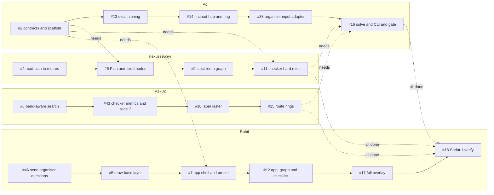

# Execution plan: who works on what, in parallel and in sequence

How the team works through the open issues so that four people stay busy and hand-offs are explicit:
- **Parallel:** one **lane per member** (their area), and the lanes run at the same time.
- **Sequential:** inside a lane, issues are done in the order shown.
- **Cross-lane arrows** are the only places where one member waits for another.

Sprints carry no dates (C36), so time is counted in **half-day slots** from the start of the sprint. The data comes from each issue's "Depends on" field, owner and size label on GitHub (2026-10-16).

**The one rule that makes this fast: contract-first.**
- #2 (the data contracts) lands in **slot 1**.
- After that, every "soft" dependency below is worked against the `contracts.py` models + fixtures/stubs, instead of waiting for the other member's code.
- Real integration is checked at the checkpoint gates (S1-A … S2-C), where every "See it" line must pass.

**Sprint 2 (revised 2026-10-16).** Sprint 1 below keeps its per-member lanes, as it ran. Sprint 2 changed after the decisions in `docs/clarifying_questions.md` (#76):
- #21 is split into #79-#82;
- #27, #28 and #29 are closed, and #49 is in Backlog;
- #78 and #83-#85 are new.

No one has a specialty, so Sprint 2 runs in **four interchangeable slots, A-D**, reassigned freely. An issue may take **several PRs**, and §2 says how much of each can be done before its dependencies land.

## 1. Sprint 1 map
Solid arrows = this member's order; dashed arrows = waits for another member's merged code.




#3 (architecture doc) is done. #47 (these docs) is not a lane item: it is closed by its own docs PR.

## 2. Sprint 2 map
Sprint 1 must be finished and verified (#18) first.

The tree reads top to bottom. **"N% before #x"** is the share of an issue that can be built and merged **before** dependency #x lands: behind a default-off setting, or not yet wired in. The issue stays open until the rest lands.

```
START NOW (no open dependencies)
├─ #78 grid: paint thin doors and passages (S, P0) ─▶ clean numbers for #32 and #84's grid case
├─ #79 ring stays in its own hub's rooms, D7 (S) ─┬─▶ #80 occupancy + rip-up (M) .......... 60% before #79 (bookkeeping, penalty, pass loop)
│                                                 │     └─▶ #82 crossings in the search (M) .. 40% before #80 (orientation, synthetic tests)
│                                                 └─▶ #81 single-door / one-node rings (M) . 60% before #79 (parallel lanes, J comparison)
├─ #19 path cache (M) ─▶ #20 exact hub + ring (M) .................. 50% before #19 (T1 text, Q4 spot rule, exact search on direct routing)
│                          └─▶ #22 rank + enumerate + robust J (S) .. 60% before #20/#80 (enumerate, rank_key, D3, fallback on today's router)
│                                ├─▶ #24 optimality badge (S) ....... 50% before #22 (T7 wording from today's sidecar)
│                                ├─▶ #26 gallery, hub-count filter (M) 40% before #22 (tab + tiles from #13/#14 first-cut arrangements)
│                                ├─▶ #34 output-format doc (S) ...... 50% before #22 (T6 rounding + test, format doc)
│                                └─▶ #44 presentation export (S) .... 70% before #22 (export today's result, CLI, plan 576 slide)
├─ #83 status banners + case tags (M) ─▶ #84 case library (S, HUMAN) . 70% before #83 (script, picks, files)
│                                          └─▶ #85 "Cases" picker (S) .. 50% before #84 (source + callout on a 2-case stub)
├─ #32 batch + CSV (M, HUMAN sample) ─▶ #33 batch tab (S) ............ 30% before #32/#83 (tab on a fixed CSV schema)
├─ #30 what-ifs (S) ................ 60% now (banner, area cap, hub offset, D5); D7 toggle after #79, D3 after #22
│    └─▶ #31 interior windows (S) .. 70% before #30 (graph, grid, checker behind the setting)
├─ #23 gate statuses (S)
└─ #25 ring step-through (S)
LATER
├─ #48 final J weights (S): only when the organisers publish (one constant + batch re-run)
├─ #21 (parent) closes when #79-#82 are closed
└─ #35 Sprint 2 verify (all four slots, last)
```

The J weights stay **hard-coded** (`ORGANISER_WEIGHTS`, D2) until dynamic weights are added later. #48 runs only when the organisers publish the final values.

## 3. Waves: what can run at the same time
A wave can start as soon as the waves before it are merged (hard dependencies only; soft ones use #2 + stubs). Every issue except #2 itself also needs **#2 merged** (slot 1), because the contracts are what the stubs are written against.

### Sprint 1
| Wave | Issues (owner) |
|---|---|
| 0 | #2 contracts + scaffold (Adi), #46 organiser questions (Rohit), #4 read plan to metres (nexuszephyr), #5 draw base layer (Rohit), #8 bend-aware search (V1702), #10 label raster (V1702), #13 exact zoning (Adi), #14 first-cut hub + ring (Adi), #43 checker metrics + slide 7 (V1702) |
| 1 | #6 Plan + fixed nodes (nexuszephyr), #7 app shell + preset (Rohit), #11 checker hard rules (nexuszephyr), #15 route rings (V1702) |
| 2 | #9 strict room graph (nexuszephyr), #12 app: graph + checklist (Rohit), #16 solve + CLI + gate (Adi), #38 organiser input adapter (Adi) |
| 3 | #17 full overlay (Rohit) |
| 4 | #18 Sprint 1 verify (Rohit) |

### Sprint 2: five days, four slots
S = ½ day, M = 1 day. Each cell runs left to right; "→" starts the next item as soon as the previous one is merged or reaches its early share.

| Day | Slot A | Slot B | Slot C | Slot D |
|---|---|---|---|---|
| 1 | #79 → #80 (60%) | #19 | #83 | #78 → #23 |
| 2 | #80 | #20 (its 50% early part fits in day 1's spare time) | #84 (**HUMAN: Adi runs the export**) → #85 (50%) | #81 |
| 3 | #82 | #22 PR1 (today's router) → #24 PR1 (T7 wording) | #85 → #26 (40%, first-cut tiles) | #32 PR1 (**HUMAN: Adi commits the 100-plan sample**) |
| 4 | #30 (D7 toggle, now that #79 is in) → #31 | #22 PR2 (#80's router) → #24 PR2 → #34 | #26 (real `enumerate()` from #22) | #32 PR2 (after #78) → #33 |
| 5 | #25 | #44 | review / buffer | review / buffer → **#35 together** |

Outside the slots:
- **Day 1:** send Q1-Q4 to the organisers (#46).
- **#48:** when the organisers publish the final weights.

## 4. Lane timeline (contract-first)
Estimates: S = 1 slot (½ day), M = 2 slots (1 day). Each slot range below is the earliest the issue can run, given its lane order and its hard dependencies.

### Sprint 1: done by slot **10**
| Member | Issue | Size | Slots | Waits for (other lanes) | Soft deps (work against stubs) |
|---|---|---|---|---|---|
| Adi | #2 contracts + scaffold | S | 1–1 | – | – |
| Adi | #13 exact zoning | M | 2–3 | – | #9 |
| Adi | #14 first-cut hub + ring | S | 4–4 | – | #13 |
| Adi | #38 organiser input adapter | S | 5–5 | – | #4, #6 |
| Adi | #16 solve + CLI + gate | M | 8–9 | #11, #15 | #43 |
| nexuszephyr | #4 read plan to metres | M | 1–2 | – | – |
| nexuszephyr | #6 Plan + fixed nodes | S | 3–3 | #2 | – |
| nexuszephyr | #9 strict room graph | M | 4–5 | – | – |
| nexuszephyr | #11 checker hard rules | M | 6–7 | #2 | #9 |
| V1702 | #8 bend-aware search | M | 1–2 | – | – |
| V1702 | #43 checker metrics + slide 7 | M | 3–4 | – | – |
| V1702 | #10 label raster | M | 5–6 | – | #6 |
| V1702 | #15 route rings | S | 7–7 | – | – |
| Rohit | #46 organiser questions (HUMAN: send) | S | 1–1 | – | – |
| Rohit | #5 draw base layer | S | 2–2 | – | – |
| Rohit | #7 app shell + preset | S | 3–3 | #2 | – |
| Rohit | #12 app: graph + checklist | S | 4–4 | – | #9, #11 |
| Rohit | #17 full overlay | M | 5–6 | – | #16 |
| Rohit | #18 Sprint 1 verify | S | 10–10 | – | – |

**Sprint 1 load** (S = 1, M = 2): Adi 7 · nexuszephyr 7 · V1702 7 · Rohit 7 slots.

### Sprint 2: slot loads (S = 1, M = 2 half-day slots)
| Slot | Issues, in order | Load |
|---|---|---|
| A | #79, #80, #82, #30, #31, #25 | 8 |
| B | #19, #20, #22, #24, #34, #44 | 8 |
| C | #83, #84, #85, #26 + reviews | 6 |
| D | #78, #23, #81, #32, #33 + reviews | 7 |

## 5. Critical path and bottlenecks
- **Sprint 1 critical path:**
  1. the nexuszephyr lane (#4 → #6 → #9 → #11, 7 slots) and the V1702 lane (#8 → #43 → #10 → #15, 7 slots) both have to finish;
  2. then **#16** (solve + CLI + gate, Adi, 2 slots) integrates them;
  3. then **#18** (verify).

  Anything that delays #11 or #15 delays the sprint, so reviews for those two come first. Still 10 slots: #38 runs in Adi's slack before #16 (slot 5) and doesn't lengthen it.
- **Sprint 2 critical path:** #19 (path cache) → #20 (exact hub + ring) → #22 (rank + enumerate + robust J) → #26 (gallery), about 4 days. The routing chain #79 → #80 → #82 (2½ days) runs alongside it. Early parts (§6) keep both chains from waiting: #20 and #22 are partly built before their dependencies, and the badge, gallery and presentation export run on today's arrangements, switching to #22's real `enumerate()` when it lands.
- **Honest capacity note.** At these estimates, Sprint 1 needs about 10 half-day slots (≈ 5.0 working days), even with contract-first. If it has to be shorter:
  - (a) pair on the two 7-slot lanes (the second person takes #11's broken fixtures, or #43's slide-7 tests);
  - (b) treat #12 and #17 polish as the first S1-C overflow;
  - (c) count M as half a day at hackathon intensity.

  Strict sequencing, with no stubs, would take ≈ 6.5 working days for Sprint 1.

## 6. Soft dependencies: how each one is unblocked early
### Sprint 1
| Issue | Depends on | Work against | Real integration checked at |
|---|---|---|---|
| #10 label raster | #6 Plan + fixed nodes | Plan model from #2 + hand-drawn opening | S1-B gate |
| #11 checker hard rules | #9 strict room graph | networkx graph built in the test fixture | S1-B gate |
| #12 app: graph + checklist | #9 strict room graph | graph from a fixture JSON | S1-B gate |
| #12 app: graph + checklist | #11 checker hard rules | stubbed violations list | S1-B gate |
| #13 exact zoning | #9 strict room graph | synthetic eligible graphs | S1-C gate |
| #14 first-cut hub + ring | #13 exact zoning | hand-given zones | S1-C gate |
| #16 solve + CLI + gate | #43 checker metrics + slide 7 | stub metrics until #43 lands | S1-C gate |
| #17 full overlay | #16 solve + CLI + gate | 5088 solution fixture from #11 | S1-C gate |

### Sprint 2: how much can be done before the dependency lands
| Issue | Depends on | Early share | What can be merged early | Integration checked at |
|---|---|---|---|---|
| #80 occupancy + rip-up | #79 | 60% | occupancy bookkeeping, penalty in `search`, pass loop | S2-A |
| #81 single-door / one-node rings | #79 | 60% | parallel-lane variant, J comparison | S2-A |
| #82 crossings in the search | #80 | 40% | oriented occupancy, synthetic crossing tests | S2-A |
| #20 exact hub + ring | #19 | 50% | T1 text, Q4 spot rule, exact search on direct routing | S2-A |
| #22 rank + enumerate + robust J | #20, #19, #80 | 60% | `enumerate()`, `rank_key`, robust scoring (D3), fallback on today's router | S2-A |
| #24 optimality badge | #22 | 50% | T7 checklist wording from today's sidecar | S2-A |
| #26 gallery | #22 | 40% | tab + tiles from #13/#14 first-cut arrangements | S2-B |
| #34 output-format doc | #22 | 50% | T6 rounding + axis-alignment test, the format doc | S2-C |
| #44 presentation export | #22 | 70% | export of today's result, CLI, plan 576 slide | S2-C |
| #84 case library | #83 | 70% | `scripts/make_cases.py`, picks, files | S2-B |
| #85 "Cases" picker | #84 | 50% | sidebar source + callout on a 2-case stub | S2-B |
| #33 batch tab | #32, #83 | 30% | tab on a fixed CSV schema | S2-C |
| #30 what-ifs | #79, #22 | 60% | banner, area cap, hub offset, D5 toggle | S2-B |
| #31 interior windows | #30 | 70% | graph, grid and checker support behind the setting | S2-B |

## 7. Integration gates
| Gate | Must pass before the next wave starts | Proof |
|---|---|---|
| Slot 1 | **#2 merged**: contracts, scaffold, fixtures, CI | `uv run pytest -q tests/test_contracts.py` |
| S1-A | #4, #5, #6, #7, #38, #46 (sent) | app shows plan 5924 with the preset; `python -m hackhive.io` prints the facts |
| S1-B | #8, #9, #10, #11, #12, #43 | `pytest -k slide7` → 8 passed; the checker validates the 5088 fixture; the app shows the graph + checklist |
| S1-C | #13, #14, #15, #16, #17 → **#18** | `hackhive solve` writes gated slide-8 submissions for all 7 fixtures; full overlay |
| S2-A | #19, #20, #22, #23, #24, #78, #79-#82 (#21), #83 | badge; J-optimal rings; rip-up; rings stay in their own hub's rooms; every outcome explained (banners and case tags) |
| S2-B | #25, #26, #30, #31, #84, #85 | gallery (hub-count filter, best J per hub count); step-through; what-ifs; every dataset case opens from the "Cases" picker |
| S2-C | #32, #33, #34, #44 → **#35** | batch 100% valid on feasible plans, with zero `grid failed` (#78); leaderboard with case counts; presentation export |

## 8. Working rules
- **Branches and PRs:** branch `<n>-<slug>`, PR titled `#<n> <title>`, small PRs merged the same day. Sprint 2: an issue may take **several consecutive PRs**. Each says `Part of #<n>`, only the last says `Closes #<n>`, and every PR keeps `main` green, with partial work behind a default-off setting or not yet wired in.
- **Tests first** from the acceptance criteria. Every PR runs `uv run ruff check . && uv run ruff format --check . && uv run pytest -q`.
- **Stubs live in tests or fixtures, never in `src/`.** When the real dependency lands, delete the stub in the same PR that switches over.
- **Review:** in Sprint 2, anyone who didn't push the PR last approves it (the `protect-main` ruleset needs one such approval). Adi reviews anything touching `contracts.py`. A slot that finishes early reviews first, then takes the next unblocked item from §2.
- **When blocked by another lane:** take the next soft-dependency item in your lane, or write the broken fixtures / tests for the blocker.
- **Backlog** (#36, #37, #39, #40, #41, #49) is picked up only after Sprint 2's gate, or by anyone idle, never ahead of a critical-path issue.
