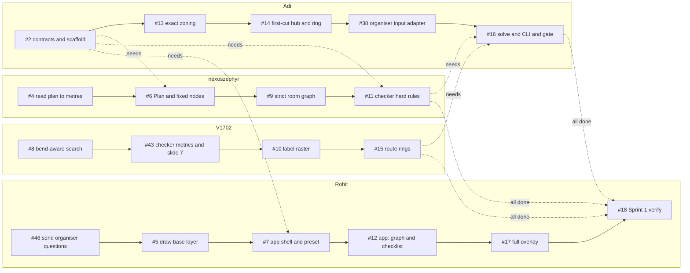
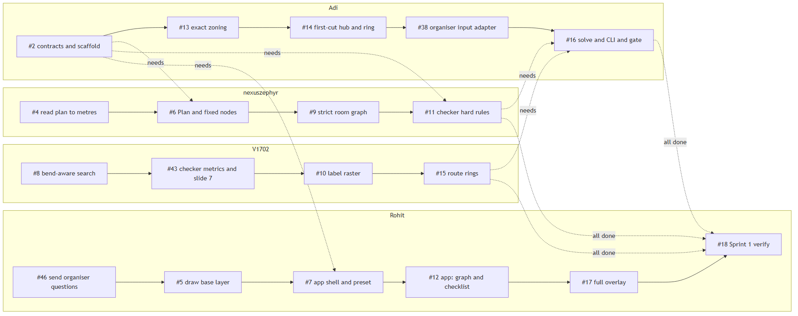
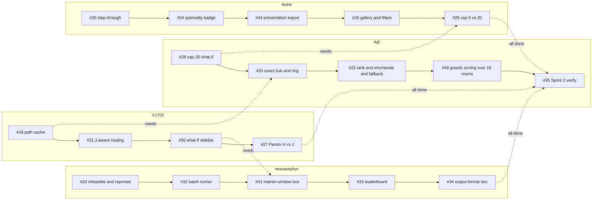
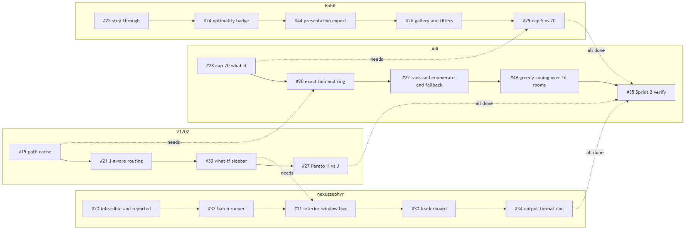

# Execution plan: who works on what, in parallel and in sequence

How the team works through the 45 open issues so that four people stay busy and hand-offs are explicit:
- **Parallel:** one **lane per member** (their area), and the lanes run at the same time.
- **Sequential:** inside a lane, issues are done in the order shown.
- **Cross-lane arrows** are the only places where one member waits for another.

Sprints carry no dates (C36), so time is counted in **half-day slots** from the start of the sprint. The data comes from each issue's "Depends on" field, owner and size label on GitHub (2026-10-16).

**The one rule that makes this fast: contract-first.**
- #2 (the data contracts) lands in **slot 1**.
- After that, every "soft" dependency below is worked against the `contracts.py` models + fixtures/stubs, instead of waiting for the other member's code.
- Real integration is checked at the checkpoint gates (S1-A … S2-C), where every "See it" line must pass.

## 1. Sprint 1 map
Solid arrows = this member's order; dashed arrows = waits for another member's merged code.

#3 (architecture doc) is done. #47 (these docs) is not a lane item: it is closed by its own docs PR.

## 2. Sprint 2 map
Sprint 1 must be finished and verified (#18) first.

#48 (final J weights) is event-triggered: it runs when the organisers publish the final weights (#46 Q7); not slotted.

## 3. Waves: what can run at the same time
A wave can start as soon as the waves before it are merged (hard dependencies only; soft ones use #2 + stubs). Every issue except #2 itself also needs **#2 merged** (slot 1), because the contracts are what the stubs are written against.

### Sprint 1
| Wave | Issues (owner) |
|---|---|
| 0 | #2 contracts + scaffold (Adi), #46 organiser questions (Rohit), #4 read plan to metres (nexuszephyr), #5 draw base layer (Rohit), #8 bend-aware search (V1702), #10 label raster (V1702), #13 exact zoning (Adi), #14 first-cut hub + ring (Adi), #43 checker metrics + slide 7 (V1702) |
| 1 | #6 Plan + fixed nodes (nexuszephyr), #7 app shell + preset (Rohit), #11 checker hard rules (nexuszephyr), #15 route rings (V1702) |
| 2 | #9 strict room graph (nexuszephyr), #12 app: graph + checklist (Rohit), #16 solve + CLI + gate (Adi), #38 organiser input adapter (Adi) |
| 3 | #17 full overlay (Rohit) |
| 4 | #18 Sprint 1 verify (Rohit) |

### Sprint 2
| Wave | Issues (owner) |
|---|---|
| 0 | #19 path cache (V1702), #21 J-aware routing (V1702), #23 infeasible + reported (nexuszephyr), #24 optimality badge (Rohit), #25 step-through (Rohit), #26 gallery + filters (Rohit), #27 Pareto H vs J (V1702), #28 cap-20 what-if (Adi), #30 what-if sidebar (V1702), #32 batch runner (nexuszephyr), #34 output-format doc (nexuszephyr), #44 presentation export (Rohit) |
| 1 | #20 exact hub + ring (Adi), #29 cap 5 vs 20 (Rohit), #31 interior-window box (nexuszephyr), #33 leaderboard (nexuszephyr) |
| 2 | #22 rank + enumerate + fallback (Adi) |
| 3 | #49 greedy zoning over 16 rooms (Adi) |
| 4 | #35 Sprint 2 verify (Adi) |

#48 (final J weights) has no wave: it runs when the organisers publish the weights (#46 Q7).

## 4. Lane timeline (contract-first)
Estimates: S = 1 slot (½ day), M = 2 slots (1 day). Each slot range below is the earliest the issue can run, given its lane order and its hard dependencies.

### Sprint 1: done by slot **10**
| Member | Issue | Size | Slots | Waits for (other lanes) | Soft deps (work against stubs) |
|---|---|---|---|---|---|
| Adi | #2 contracts + scaffold | S | 1–1 | – | – |
| Adi | #13 exact zoning | M | 2–3 | – | #9 |
| Adi | #14 first-cut hub + ring | S | 4–4 | – | #13 |
| Adi | #38 organiser input adapter | S | 5–5 | – | #4, #6 |
| Adi | #16 solve + CLI + gate | M | 8–9 | #11, #15 | #43 |
| nexuszephyr | #4 read plan to metres | M | 1–2 | – | – |
| nexuszephyr | #6 Plan + fixed nodes | S | 3–3 | #2 | – |
| nexuszephyr | #9 strict room graph | M | 4–5 | – | – |
| nexuszephyr | #11 checker hard rules | M | 6–7 | #2 | #9 |
| V1702 | #8 bend-aware search | M | 1–2 | – | – |
| V1702 | #43 checker metrics + slide 7 | M | 3–4 | – | – |
| V1702 | #10 label raster | M | 5–6 | – | #6 |
| V1702 | #15 route rings | S | 7–7 | – | – |
| Rohit | #46 organiser questions (HUMAN: send) | S | 1–1 | – | – |
| Rohit | #5 draw base layer | S | 2–2 | – | – |
| Rohit | #7 app shell + preset | S | 3–3 | #2 | – |
| Rohit | #12 app: graph + checklist | S | 4–4 | – | #9, #11 |
| Rohit | #17 full overlay | M | 5–6 | – | #16 |
| Rohit | #18 Sprint 1 verify | S | 10–10 | – | – |

**Sprint 1 load** (S = 1, M = 2): Adi 7 · nexuszephyr 7 · V1702 7 · Rohit 7 slots.

### Sprint 2: continues to slot **17** (counted from the start of Sprint 1)
| Member | Issue | Size | Slots | Waits for (other lanes) | Soft deps (work against stubs) |
|---|---|---|---|---|---|
| Adi | #28 cap-20 what-if | S | 10–10 | – | – |
| Adi | #20 exact hub + ring | M | 11–12 | #19 | – |
| Adi | #22 rank + enumerate + fallback | S | 13–13 | – | – |
| Adi | #49 greedy zoning over 16 rooms | S | 14–14 | – | – |
| Adi | #35 Sprint 2 verify | S | 17–17 | – | – |
| nexuszephyr | #23 infeasible + reported | S | 10–10 | #16 | – |
| nexuszephyr | #32 batch runner | M | 11–12 | #16 | – |
| nexuszephyr | #31 interior-window box | S | 13–13 | #30 | – |
| nexuszephyr | #33 leaderboard | S | 14–14 | #7 | – |
| nexuszephyr | #34 output-format doc | S | 15–15 | – | #22 |
| V1702 | #19 path cache | M | 8–9 | – | – |
| V1702 | #21 J-aware routing | M | 10–11 | – | – |
| V1702 | #30 what-if sidebar | S | 12–12 | #16 | – |
| V1702 | #27 Pareto H vs J | S | 13–13 | – | #22 |
| Rohit | #25 step-through | S | 11–11 | – | – |
| Rohit | #24 optimality badge | S | 12–12 | – | #22 |
| Rohit | #44 presentation export | S | 13–13 | – | #22 |
| Rohit | #26 gallery + filters | M | 14–15 | – | #22 |
| Rohit | #29 cap 5 vs 20 | S | 16–16 | #28 | – |

## 5. Critical path and bottlenecks
- **Sprint 1 critical path:**
  1. the nexuszephyr lane (#4 → #6 → #9 → #11, 7 slots) and the V1702 lane (#8 → #43 → #10 → #15, 7 slots) both have to finish;
  2. then **#16** (solve + CLI + gate, Adi, 2 slots) integrates them;
  3. then **#18** (verify).

  Anything that delays #11 or #15 delays the sprint, so reviews for those two come first. Still 10 slots: #38 runs in Adi's slack before #16 (slot 5) and doesn't lengthen it.
- **Sprint 2 critical path:** #19 (path cache) → #20 (exact hub + ring) → #22 (rank + enumerate + fallback). The gallery, badge, Pareto and presentation export run in parallel against the stubbed arrangement list and switch to #22's real `enumerate()` when it lands.
- **Honest capacity note.** At these estimates, Sprint 1 needs about 10 half-day slots (≈ 5.0 working days), even with contract-first. If it has to be shorter:
  - (a) pair on the two 7-slot lanes (the second person takes #11's broken fixtures, or #43's slide-7 tests);
  - (b) treat #12 and #17 polish as the first S1-C overflow;
  - (c) count M as half a day at hackathon intensity.

  Strict sequencing, with no stubs, would take ≈ 6.5 working days for Sprint 1.

## 6. Soft dependencies: how each one is unblocked early
| Issue | Depends on | Work against | Real integration checked at |
|---|---|---|---|
| #10 label raster | #6 Plan + fixed nodes | Plan model from #2 + hand-drawn opening | S1-B gate |
| #11 checker hard rules | #9 strict room graph | networkx graph built in the test fixture | S1-B gate |
| #12 app: graph + checklist | #9 strict room graph | graph from a fixture JSON | S1-B gate |
| #12 app: graph + checklist | #11 checker hard rules | stubbed violations list | S1-B gate |
| #13 exact zoning | #9 strict room graph | synthetic eligible graphs | S1-C gate |
| #14 first-cut hub + ring | #13 exact zoning | hand-given zones | S1-C gate |
| #16 solve + CLI + gate | #43 checker metrics + slide 7 | stub metrics until #43 lands | S1-C gate |
| #17 full overlay | #16 solve + CLI + gate | 5088 solution fixture from #11 | S1-C gate |
| #24 optimality badge | #22 rank + enumerate + fallback | bounds already in the #16 sidecar | S2-A gate |
| #26 gallery + filters | #22 rank + enumerate + fallback | first-cut arrangements from #13 + #14 | S2-B gate |
| #27 Pareto H vs J | #22 rank + enumerate + fallback | same stub list as #26 | S2-B gate |
| #34 output-format doc | #22 rank + enumerate + fallback | the format is fixed by #2 | S2-C gate |
| #44 presentation export | #22 rank + enumerate + fallback | #16 Result | S2-C gate |

## 7. Integration gates
| Gate | Must pass before the next wave starts | Proof |
|---|---|---|
| Slot 1 | **#2 merged**: contracts, scaffold, fixtures, CI | `uv run pytest -q tests/test_contracts.py` |
| S1-A | #4, #5, #6, #7, #38, #46 (sent) | app shows plan 5924 with the preset; `python -m hackhive.io` prints the facts |
| S1-B | #8, #9, #10, #11, #12, #43 | `pytest -k slide7` → 8 passed; the checker validates the 5088 fixture; the app shows the graph + checklist |
| S1-C | #13, #14, #15, #16, #17 → **#18** | `hackhive solve` writes gated slide-8 submissions for all 7 fixtures; full overlay |
| S2-A | #19-#24, #49 | badge, J-optimal rings, fallback, infeasible plans explained |
| S2-B | #25-#31 | gallery with filters, step-through, Pareto, cap 5 vs 20, what-ifs |
| S2-C | #32, #33, #34, #44 → **#35** | batch 100% valid on feasible plans; leaderboard; presentation export |

## 8. Working rules
- **One issue = one branch** `<n>-<slug>` = one PR, titled `#<n> <title>`, with `Closes #<n>`; small PRs merged the same day.
- **Tests first** from the acceptance criteria. Every PR runs `uv run ruff check . && uv run ruff format --check . && uv run pytest -q`.
- **Stubs live in tests or fixtures, never in `src/`.** When the real dependency lands, delete the stub in the same PR that switches over.
- **Review buddy:** Adi ↔ nexuszephyr, V1702 ↔ Rohit; Adi reviews anything touching `contracts.py`.
- **When blocked by another lane:** take the next soft-dependency item in your lane, or write the broken fixtures / tests for the blocker.
- **Backlog** (#36, #37, #39, #40, #41) is picked up only after Sprint 2's gate, or by anyone idle, never ahead of a critical-path issue.
